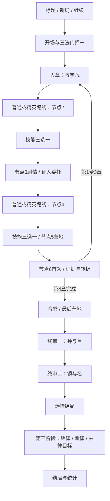

# 《天规：无名之人》完整游戏需求与构建验收规范

文档版本：1.0 · 2026-10-18

需求基线：Celestial Law 完整主线 0.6，包含自动追踪/发射、三法门、技能联动、封存机制。

基线提交：`02890554982fa764fa5da1cf0f7eaf3b6a92f33f`。

用途：作为独立输入，测试模型从零构建完整可玩游戏的能力。

> **交付给构建模型时，只需提供本文件。** 不需要现有源码、图片、旧策划、视频或网络资料。本文是目标需求，不是现有原型已经逐项通过验收的证明。允许重新实现和原创表现，禁止用静态页面、菜单演示、自动播放或虚构测试结果代替游戏。

## 0. 阅读约定与需求边界

- **必须（MUST）**：影响完整性、机制或验收的要求。没有特别标记的正文规则均为必须。
- **建议（SHOULD）**：提升手感、表现与维护性的目标；未完成需在交付说明中披露。
- **可选（MAY）**：拓展，不计基础完成分，不得挤占必须项。
- 数值是统一验收基准。可以提出平衡建议，但交付基准模式必须符合本文；另设实验模式才能修改数值。
- 坐标单位是逻辑画布单位，“步”与单位同义；时间以游戏内秒计。所有持续时间和冷却在暂停时冻结。
- 容许误差：位置与半径 ±1 单位；持续时间 ±1 个逻辑更新步；浮点伤害 ±0.01。不能用容差改变条件的等号含义。
- 美术、文案可以原创；核心名词、技能名、剧情事实、数值、胜负条件必须可对应。无需复刻源项目像素或文件架构。
- 旧版 Demo、独立试炼、圣物四槽、联网、账号、内购、程序生成大地图、移动端触控、长期属性成长树均不在必做范围。
- 本文补齐了原型未充分明确的升级、事件顺序、终局竞态和异常存档规则，见第 17 节。出现冲突以本文为准，不要求复现原型缺陷。

## 1. 产品目标与核心体验

**P-01** 制作一款中文、俯视角、即时战斗、单人动作肉鸽游戏。主题是黑暗中式修仙与规则怪谈：天规按字面条件裁决所有生者，不判断善恶。玩家既要守规避罚，也要用推击、纸人、印记、镜影和归责把敌人送入裁决条件。

**P-02** 一局从报丧村出发，连续经历回首祠、倒悬寺、无名城、登天台，最后在战场上完成三种结局之一。构筑、生命、香火和剧情进度贯穿整局，不能以五个互不关联的小 Demo 代替。

**P-03** 玩家主要负责移动、布纸人、震步、闪避、闭目和场景互动。飞剑必须自动发射、自动追踪，不要求持续按 J 或鼠标。鼠标控制角色朝向与纸人落点，自动瞄准不能擅自改变玩家朝向。

**P-04** 技能需要形成可解释的事件链：自动剑 → 律印 → 推移 → 落雷/裁决 → 追击剑/灯烬 → 新的动作机会。至少支持剑印、纸阵、震雷三条起步路径，也允许跨流派混搭。

**P-05** 规则预警必须足以让首次玩家理解“为什么受罚、如何把相同条件用于敌人”。不得把判定藏在不可见的随机条件中。

目标平台为桌面浏览器；键盘和鼠标为标准输入。无需登录，运行中不依赖网络、远程图片、CDN 或付费 API。允许静态页面或常见前端技术；如需构建，提供锁定依赖和一条明确的安装/启动命令。

## 2. 世界观、人物与主线

### 2.1 不可改变的故事事实

**N-01** 妹妹阿照成为天灯后，名字从家谱和人的记忆中消失。玩家持红绳纸人追索她的去向。纸人只是传话和诱敌的空壳，销毁它不会伤害阿照。

**N-02** 第一章发现阿照自愿入祠，替“无名者”承罚，并非简单被恶人绑走。第二章发现她要救的人是玩家。抹去姓名并不能逃避针对“生者”的判词。

**N-03** 第三章揭示玩家曾写下“无主之罚，由无名者承受”，以为可以保护有名者，却制造了另一群承罚者。玩家必须承认自己是旧律的执笔者。

**N-04** 第四章寻找仍能亲自作证的人。保护不能等同替他人签字，纸人的代罚不能代替证人的同意。四地证人形成共律结局的条件。

**N-05** 第五章没有突然引入第五套无关规则，而是重组前四律，逼玩家选择承担、拆毁或共同改写。三结局都救援阿照，但付出的责任与社会后果不同。

| 人物 | 角色与必须承担的叙事功能 |
|---|---|
| 玩家／无名之人 | 救妹者，也是旧条款执笔者；从逃罚转向承担修改规则的责任 |
| 阿照 | 主动做出选择的妹妹；通过纸笺、天灯和证词发声；不是无人格的奖励 |
| 素娘 | 纸扎匠，引导纸人使用、寄名与证人登记 |
| 闻烛 | 保留旧档的见证人，指出玩家的责任；不替玩家决定结局 |
| 执衡 | 终审执行者，也受已经登记的判词约束 |
| 四地证人 | 引路人、盲证人、抄经人、守灯人；经保护后自愿留下证言 |

### 2.2 证据与叙事交付

**N-06** 案卷可随时查阅已取得证据。取得时显示短文、来源和下一步目标；不能一次把全部谜底堆在开场。至少包含下表九项，解锁后跨局保留。

| 证据 | 取得节点 | 必须传达的信息 |
|---|---|---|
| 红绳纸人 | 开场 | 阿照留下“天亮之前，别让他们把最后一笔写完”；纸人是空壳 |
| 天灯转运簿 | 第一章节点 3 | 阿照自愿入祠，代无名者承罚 |
| 报丧人的归责印 | 第一章首领后 | 执行者也受律约束，灵牌移动可以归责到本体 |
| 盲证人的口供 | 第二章节点 3 | 阿照询问抹去姓名能否救人 |
| 神像背面的证词 | 第二章首领后 | 被救的无名者是玩家，旧字迹指向倒悬寺 |
| 执笔旧档 | 第三章节点 3 | 玩家写下无主之罚条款 |
| 闻烛的证言 | 第三章首领后 | 旧律可以改变，但必须承担责任 |
| 无名者名册 | 第四章节点 3 | 四位证人需要本人同意，不得以纸人代签 |
| 天规原本 | 第四章首领后 | 可以用证据让执行者接受相同审判 |

剧情文字可改写，但每章至少有入章引导、节点 3 的发现、首领后的转折。剧情面板冻结战斗，可逐段继续；已读内容可跳过，关键证据仍需入卷。通关后再次起行可称“旧案重演”。

## 3. 一局结构、章节与房间

### 3.1 流程图

**F-01** 前四章各六个节点，第五章三个节点，共 27 个流程节点。前四章各有四场战斗，共 16 场；终审三个战斗阶段。因此完整一局有 19 个战斗段，不要求把剧情与营地伪装成战斗房。

| 章／主律 | 节点 1：教学战 | 节点 2：路线战 | 节点 3：剧情 | 节点 4：综合战 | 节点 5：营地 | 节点 6：首领 |
|---|---|---|---|---|---|---|
| 报丧村／钟 | 止步巷 | 棺阵侧院 | 转运簿 | 押灵路 | 残香庙 | 祖祠·报丧人 |
| 回首祠／目 | 独眼庭 | 屏风廊 | 盲证人 | 驱纸院 | 祠外灯亭 | 背神台·守祠人 |
| 倒悬寺／镜 | 分影阶 | 移镜廊 | 执笔旧档 | 倒影庭 | 闻烛灯室 | 悬镜殿·映身僧 |
| 无名城／名 | 寄名门 | 归责坊 | 无名者名册 | 夺名街 | 众灯亭 | 销名府·司名官 |

第五章为“四案合卷 → 最后一盏香 → 终审·执衡”。终审节点包含三个连续阶段，不是三个只换标题的同类房间。

### 3.2 关卡职责

**F-02 报丧村**：用第一次七秒钟声教玩家停步；棺材作为碰撞与推击阻挡；后续混入冲锋者，使“站住”和“躲敌人”产生冲突；首领用归责灵牌揭示本体之外的责任载体。

**F-03 回首祠**：首次展示神像视锥、转头和闭目；屏风遮挡视线；后续加入清纸敌人；首领双像轮流裁决，使纸人朝圣、闭目和朝向选择都有实际价值。

**F-04 倒悬寺**：显示同血的本体与镜影、红线和镜轴；引导 F 拖镜架与 Q 推镜影；综合战同时要求控制敌人和调镜；首领半血改变镜轴。

**F-05 无名城**：显示当前被叫到的名字、持牌者和登记状态；引导转移牌和撤销登记；综合战让接近敌人转牌与保持安全发生冲突；首领半血把牌召回玩家。

**F-06** 不要求随机迷宫。每类房间可为固定单屏布局，但需要有碰撞障碍、可达通路和与章节相关的视觉物件。不得把主机制完全遮挡、把敌人生成在墙内，或把关键交互点放在不可达处。

### 3.3 波次、奖励与证人

| 战斗节点 | 初始普通敌人 | 后续波次 | 特殊条件 |
|---|---:|---:|---|
| 节点 1 | 4 | 无 | 本章规则教学 |
| 节点 2 | 5 | 4 | 开战前普通／精英二选一 |
| 节点 4 | 7 | 4 | 普通／精英二选一，可有证人任务 |
| 节点 6 | 3，加首领 | 无 | 首领半血机制 |
| 终审每阶段 | 2，加执衡 | 见结局补员规则 | 复用前四律 |

**F-07** 第一波清空后生成第二波，并保证下一次裁决至少还有 3 秒。所有波次结束且证人任务已结算才清房。普通战获得 25 香火，精英路线获得 45 香火；精英普通敌人额外 +24 生命。每次正常房间清算恢复 10 命火，最多至上限，死亡后不得结算回血。

**F-08** 节点 2、4 清房后各获得一次技能奖励，四章共八次，加上开场起步技能共九次技能获取机会。节点 1 无技能三选一。第一章首领后额外允许一次免费升级，亦可放弃；其他首领不额外赠送这一服务。

**F-09** 每章节点 3 可接受或放弃本章证人委托。接受后在节点 4 出现证人，位置参考 `(560,495)`，保护值 2，持续两轮环境裁决。每轮裁决伤害结算后，若 110 单位内还有存活敌人，保护值减 1；同一轮再多敌人也只减 1。每轮任务进度加 1；两轮后保护值大于 0 则成功，否则失败。敌人提前清空仍等待两轮完成，不能卡在无敌人但不走时钟的状态。

**F-10** 成功证言跨局保存且不重复累计；失败或放弃不阻断主线。证人不是可消耗纸人，无攻击能力，不占纸人数，不应用替身契代罚。四证齐备后，在终审合卷界面主动确认共律新约；条件与缺失证人列表均可见。

## 4. 基础空间、输入和战斗

### 4.1 世界尺度与操作

**C-01** 参考逻辑画布 1120×680，角色中心可活动范围 x=65…1055、y=115…615。角色半径 14，普通敌人 16，首领 29，纸人 12。玩家进房初始位置 `(560,570)`。允许整体同比缩放，必须保持数值对应关系和鼠标坐标换算正确。

| 操作 | 行为 |
|---|---|
| WASD／方向键 | 移动；对角线归一化，无加速优势 |
| 鼠标移动 | 角色朝向、纸人目标落点；不承担开火要求 |
| 自动飞剑 | 有合法目标且冷却归零时发射 |
| Q | 震步：范围推击 |
| E | 放置纸人 |
| Space | 闪避；无移动输入时沿角色朝向 |
| Shift 按住 | 闭目；移速减半，停止自动剑与 Q，免目律但不免其他律或普通伤害 |
| R | 本章一次修订天规，打开选择面板 |
| F | 上下文交互：镜架、名牌、登记、灵牌、终局目标 |
| P／Esc | 暂停或关闭当前可返回面板 |
| 屏幕按钮 | 案卷、帮助、声音设置；必须可返回原状态 |

**C-02** 基础生命（命火）100，移动速度 210/秒；闭目为 105/秒。闪避速度 700/秒，持续 0.16 秒，冷却 2 秒，启动后 0.25 秒普通伤害无敌。碰墙停住，不得越出地图。技能冷却不得小于 0。

### 4.2 自动追踪飞剑

**C-03** 默认伤害 16，间隔 0.34 秒，飞行速度 640/秒，寿命 1.8 秒。选择最近、存活、与发射点有无遮挡直线的敌人。没有合法敌人时不发射。目标死亡或已被本剑贯穿后，重新选择未被本剑命中过的合法敌人；没有目标则保持最后方向至到期或碰撞。

**C-04** 每一更新步朝当前目标修正飞行方向；不是仅发射瞬间瞄准。飞剑碰墙和越界消失，不能穿墙自动索敌。纸人剑、借律追击剑、法门附加剑同样自动追踪，但保留不同伤害来源。敌方子弹为直线弹，不自动追踪。

**C-05** “主动剑”指玩家主武器自动射出的剑，不代表需要手动按键。主动连击只统计成功命中，每第三次命中触发；空射不加计数，跨房不清零。贯穿命中不同敌人分别计数。同一实体本体和镜影不得被同一剑重复计数。

### 4.3 震步、纸人、普通伤害

**C-06** Q 半径 165，推击初速 400，冷却 3.5 秒；首领推力减半。推移速度按 `v(t)=v0×exp(-5t)` 衰减。标记“由玩家推动”保留 2 秒，但必须实际位移才满足需要移动的判定；堵墙时速度意图不能冒充位移。Q 命中首领令其破防 2 秒。

**C-07** E 最远落点 260，纸人持续 8 秒，普通攻击可承受 2 次；冷却 6 秒。落点需投射到有效可达地面，不能置入墙中；失败可回退玩家身边。来自所有技能的纸人共用上限 3，超出移除最早一只。敌人优先追最近纸人，否则追玩家；纸人不是生者，不承受环境裁决。

**C-08** 普通敌人接触伤害 7，首领 14，敌方弹伤害 8。玩家受普通伤害后无敌 0.65 秒；环境裁决伤害 16，不受普通无敌帧保护。纸身、转罚、替身等明确机制另算。生命归零即失败，后续触发不得把玩家复活。

## 5. 统一天规系统

### 5.1 裁决时序

**L-01** 每 7 秒一次环境裁决；最后 1.5 秒明确预警，显示倒计时、判词、危险范围和玩家当前是否触犯。使用实际位移、实际朝向和当前归责状态，不能随机判罚。

**L-02** 每轮依序执行：

1. 固定本轮生效律种与修订，执行“纸人朝圣”等裁决前动作。
2. 对存活生者采集是否有罪、命中前律印等快照。
3. 根据快照结算环境伤害及转罚、技能联动；已死亡目标不再重复处理。
4. 玩家若已死立即终止；否则结算证人和终局保护物受损。
5. 先判断保护失败，再判断轮数/破柱/击杀等胜利条件。
6. 若仍战斗，选择下一律种、刷新七秒计时与每轮交互额度。

**L-03** 对敌环境基础伤害：第一章 88，其余章节与终审 110。对玩家为 16。尸体和纸人免罚；纸身中的玩家免全部生者裁决。玩家确实有罪时，转罚优先级为：断律正确绑定柱 → 有效偷名符名契 → 有效替身契纸人 → 玩家受罚。前一项成功不消耗后一项资源。

### 5.2 四律精确定义

#### L-04 钟律：钟响之刻，动者受罚

以该逻辑步碰撞后的实际速度判定：大于 16/秒为移动，等于或小于 16 为静止。原律罚移动者；反转罚静止者。敌人一般在原钟律最后 0.9 秒停止自主移动，但已有冲锋与玩家强制位移可以继续。闪避算移动，闭目不豁免。归责灵牌的实际移动可以计入报丧人移动。

例：推向墙壁但未产生实际移动的敌人，在原钟律下不能因“仍有推力变量”而受罚。

#### L-05 目律：被神像看见，且面朝神像者受罚

神像参考位置 `(560,205)`；视距 430，半角 0.66 弧度，距离须大于 30 且不超过 430。与神像之间有实心障碍则不可见。角色朝向与指向神像的向量夹角不超过 π/3 为面朝，其他为背对。

原律罚“可见且面朝”；反转罚“可见且背对”。范围外、屏风后、闭目者两种判词都安全。神像平时以最多 0.5 弧度/秒转向目标方向，最后 1.5 秒锁定，不能在裁决瞬间突然转脸。初始方向朝南；教学房可小幅扫视，后续范围扩大。首领双像场每轮只有一尊有效，必须标清是哪一尊。

例：玩家鼠标指向南方、神像位于北方时为背对；自动剑追踪北方敌人不应把玩家转成面朝神像。

#### L-06 镜律：本体与镜影分居红线两侧者受罚

红线 x=560；镜轴初始 x=560；镜影位置为 `imageX=2×axisX-bodyX+offsetX`，`imageY=bodyY`。设 a=bodyX−560，b=imageX−560：原律 a×b<0 时有罪；反转 a×b>0 时有罪。本体或镜影距红线不超过 12 时作为缓冲区免罚，优先于乘积判定。

F 在镜架 130 内切换拖动；拖动时镜轴跟随玩家 x 并限制在 280…840，镜架 y 跟随玩家 y−50 并限制在 150…550。Q 可推附近镜影，横向偏移增量为推击方向 x 分量×90；也可推首领镜影。本体和镜影只有一条生命、一个身份；不能重复掉落、重复死亡或双倍受同一剑伤害。

例：镜轴 560，本体 x=400，镜影 x=720，原律有罪；镜轴改为 450，镜影 x=500，两者同侧，原律安全；本体 x=550 时进入 12 单位缓冲，安全。

#### L-07 名律：被点名且已登记者受罚

场上有一块环境点名牌，记录持有者与是否登记；初始在玩家身上且已登记。没有姓名的玩家使用临时寄名，不能自动免罚。原律罚“持牌且已登记”；反转罚“持牌且未登记”；其他生者不受该轮名律罚。

F 转牌：玩家在持牌者 150 内，且另一个存活敌人在玩家 150 内时，转给最近的另一敌人；每轮最多一次。北侧登记台 `(560,190)` 周围 90 内按 F 可切换登记/撤销；若两个交互同时可用，登记台优先，提示必须匹配。每两轮裁决后将牌重新召回玩家并恢复已登记。持牌敌人死亡后显示“名牌待召回”，本轮不另选替罪者，到约定召回周期再恢复。

环境点名牌与偷名符的技能名契是两个独立状态。转牌不自动消耗技能名契，技能名契也不改变登记状态。

### 5.3 修订判词

**L-08** 每章一次 R；进入新章恢复，终审三个阶段合计一次。打开菜单暂停，取消不消耗；确认后本章不能再改。二选一：

- **反转条件**：钟罚静止，目罚背对，镜罚同侧，名罚未登记；其他条件和安全区仍保留。
- **只罚妖物**：环境裁决免罚玩家，对敌环境伤害为原数值 65%，触犯条件不变。

不能同时拥有两种修订。终审只修改确认时选中的那一种律，不扩散到其他律；进入阶段不刷新次数。断律结局强制恢复四条原律并禁用 R，界面说明原因。

## 6. 敌人与首领

### 6.1 敌人配置

**E-01** 普通敌人生命：第一章 105，之后 135；节点 4 再 +20；精英节点 2/4 再 +24。修订不会直接改变生命。默认移动速度 62，追纸人优先；接触攻击间隔 1 秒。

| 类型 | 行为和识别 |
|---|---|
| 行尸 | 追逐与接触攻击，给玩家最初的推击目标 |
| 冲锋妖 | 平时速度 90；每约 3.3 秒锁定方向冲锋，速度 250、持续 0.55 秒；首次等待约 3 秒，必须有起手提示 |
| 射手 | 发射直线弹，速度 160、寿命 4 秒、间隔 3.5 秒；移动可被纸人吸引，但射击瞄准玩家 |
| 清纸妖 | 接近纸人 40 内，一次造成 2 次纸人耐久伤害，攻击间隔 1.2 秒；第二章综合战起出现，形象与普通敌人可辨 |

后续章节必须混合至少两种敌人，使规则与走位形成压力。初始敌人分布在场地中上方，不能贴脸生成；出生位置与波次可以种子变化，但数量、数值和可达性固定。

### 6.2 首领公共规则与变化

**E-02** 报丧人生命 850，其余首领及执衡每阶段 1050；速度 48，接触伤害 14；首领直线弹间隔 1.8 秒。推力减半。第二章开始，裁决前最后 1.5 秒首领普通伤害减半；有律印或 Q 破防剩余时间大于 0 则不减。规则伤害不被该护体减免。

**E-03 报丧人**：生命首次降至一半时生成归责灵牌 `(700,430)`、半径 18。灵牌接受全额推力，与本体不是两只怪，没有独立生命。F 在 130 内可牵引；跟随距离约 55，速度上限 220；牵引时玩家移速乘 0.65。钟律以本体和灵牌实际移动速度较大者判断首领是否移动。

**E-04 守祠人**：半血生成两尊神像 `(380,205)` 与 `(740,205)`，每轮交替有效；变化时保证至少 2 秒反应时间。纸人诱导、闭目、屏风仍然有效。

**E-05 映身僧**：本体与镜影共享生命；半血把镜轴移到 x=650，给至少 3 秒预警；玩家仍可拖镜与推影，不能只播放镜影动画而无判定变化。

**E-06 司名官**：半血将点名牌召回玩家并登记，至少留 3 秒处理时间；必须可再次利用归责机制反制，不能直接扣血当作“名律”。

**E-07 执衡前两阶段**：第一阶段每轮在钟、目之间轮换，从钟开始；第二阶段镜、名轮换，从镜开始。每阶段清除首领和随从才前进；第一阶段后回复 25 命火，重置场内实体与房间冷却；第二阶段后进入结局选择，不直接通关。

## 7. 法门、构筑槽位与组合

### 7.1 起始法门

**B-01** 新局展示三张法门卡，选择一张永久决定本局法门，并获得对应的一级起步技能。法门本身不占技能槽，起步技能占一槽；可以替换起步技能，但不移除法门的收益与代价。所有法门可使用全部技能。

| 法门 | 起步技能 | 收益 | 代价 |
|---|---|---|---|
| 剑印 | 篆剑诀 | 每第三次主动剑命中有印目标后，额外发射两柄各 8 伤害追踪剑 | 主动剑基础伤害由 16 降为 12 |
| 纸阵 | 留影步 | E 同时生成两只纸人，第二只参考向右偏移 48，碰撞时找合法邻近位置 | E 冷却由 6 增至 8 秒；总上限仍为 3 |
| 震雷 | 追雷印 | Q 冷却由 3.5 降为 2.6 秒 | 主动剑间隔由 0.34 增至 0.42 秒 |

剑印附加剑不计主动连击，不触发主动剑技能。当前命中由篆剑诀刚施加的律印可使剑印法门触发。纸阵放两只只算一次 E，纸身与冷却按一次施法计算。

### 7.2 槽位与成型组合

**B-02** 最多 8 个不同技能，其中最多 2 个桥接技能。技能不重复装备，等级 1…3；重复奖励不能绕过上限。满槽选择新技能进入替换界面，取消不改变奖励；替换后新技能一级，被替换技能和等级立即消失。

**B-03** 同时装备组合的三项技能自动激活效果，不需额外按钮、不额外占槽、不限定法门。少任何一项立即失效。显示已拥有组件、缺件和成型效果，不得只有发光名称。

| 组合 | 三项组件 | 实际附加效果 |
|---|---|---|
| 剑律循环 | 篆剑诀＋借律成剑＋断案诀 | 借律追击剑命中补律印，剩余时间至少 3 秒；仍不算主动剑 |
| 百纸送葬 | 留影步＋纸上行军＋焚身经 | 行军脉冲先给敌人至少 3 秒律印，再推动，可衔接追雷 |
| 震雷回流 | 追雷印＋回风诀＋定身敕 | 追雷击中处于定身的目标时，对 125 内其他敌人造成 15 规则伤害；该溅射为终止事件 |

## 8. 全部 24 项技能

### 8.1 升级公约

**S-00** 16 项常规、8 项桥接。每项最多三级。定义 `s=1+0.15×(等级−1)`，即 1 / 1.15 / 1.30。下表“升级项”以外的数值不变；不得简单给所有描述写“增强 15%”而实际无变化。相同技能只有最高装备等级生效，时间刷新取较大剩余值，不叠加无限时长。

穿山引、灯尽剑生的升级收益是本规范补充明确的目标；其他技能也用“升级项”限定缩放范围。桥接属性、槽数、触发次数上限均不随等级变化。

### 8.2 常规技能（16 项）

| ID／名称 | 一级效果与触发条件 | 升级项 |
|---|---|---|
| S-01 `inscribe` 篆剑诀 | 主动剑命中施加 6 秒律印；默认纸人剑、法门剑、借律剑不施印 | 律印持续时间 6×s |
| S-02 `third` 三叠浪 | 每第三次主动剑命中，沿玩家至目标方向推击，初速 380；首领半量，归责灵牌全量 | 推击初速 380×s |
| S-03 `force` 撼山步 | Q 范围变为 165×1.25；推力变为 400×1.2 | 只将增幅后范围再乘 s；推力固定 480 |
| S-04 `echo` 留影步 | 闪避在起点留下持续 4 秒纸人；共享三纸人上限 | 留影纸人寿命 4×s |
| S-05 `substitute` 替身契 | 玩家有罪且转罚未成功，消耗 180 内最近纸人免本次罚；冷却 8 秒；消耗算毁纸 | 可用距离 180×s |
| S-06 `pilgrim` 纸人朝圣 | 目律快照前，纸人 150 内敌人转向有效神像；反转目律时可能保护敌人。钟律中 E 使附近敌人面向纸人并减速 25% 持续 1 秒 | 作用范围 150×s |
| S-07 `turret` 借尸还剑 | 纸人优先向有印且可见敌人每 1.2 秒发剑；无此目标则每 2.4 秒攻击最近可见敌人。基础伤害 9.6，从纸人位置发射 | 伤害 9.6×s；不随剑印法门降到 7.2 |
| S-08 `thunder` 追雷印 | Q 给命中敌人 6 秒印；有印且被玩家实际推动速度>16时预约 1 秒后落雷，35 规则伤害并消耗印。每目标触发冷却 3 秒 | 落雷伤害 35×s |
| S-09 `chain` 连坐经 | 非终止规则伤害击杀时，对尸体 125 内其他敌人造成 30 终止规则伤害；不再连坐或借律 | 伤害 30×s |
| S-10 `pierce` 穿山引 | 主动剑最多命中三个不同敌人；首击 100%，第二、第三击各为初始伤害 70%，并保留主动命中效果 | 后续系数二级 80%、三级 90%；不增加目标数 |
| S-11 `return` 回锋诀 | 主动剑命中命中前已有印的目标，闪避剩余冷却减 0.04 秒；每一秒窗口最多返还 0.4 秒 | 单次返还 0.04×s；窗口上限不变 |
| S-12 `seal` 定身敕 | Q 命中有印者，推移结束后定身 1.2 秒并锁朝向；无印者只减速 25% 持续 2 秒。追雷的 Q 施印先执行，所以两者可配合 | 定身时间 1.2×s |
| S-13 `wind` 回风诀 | 被玩家推动后的 2 秒内，受到非终止规则伤害，返还 Q 冷却 0.8 秒；每根事件最多三次 | 单次返还 0.8×s |
| S-14 `burn` 焚身经 | 纸人被敌人击毁或被替身消耗时，对 120 内敌人造成 35 普通直接伤害并以初速 225 推开；到期、超额移除不触发 | 爆破伤害 35×s；推力和范围固定 |
| S-15 `drink` 饮雷经 | 每根非终止规则伤敌事件最多获得 1 灯烬，上限 3；每累计三个有效获烬事件回复 3 生命，每房最多回复 12 | 治愈量 3×s；每房上限仍 12，烬上限仍 3 |
| S-16 `mandate` 代天行罚 | 环境裁决或追雷命中有印者，消耗印，让这次伤害提高 30%；借律仍读取消耗前的印 | 增伤比例 0.30×s，即最高 39%，不是总伤害再乘 s |

表中的 `6×s`、`380×s` 等表示“数值乘缩放系数 s”，不是秒的缩写；时间单位已在效果栏说明。例如三级篆剑诀为 7.8 秒，三级代天行罚为 39% 增伤。

### 8.3 桥接技能（8 项）

| ID／名称 | 一级效果与边界 | 升级项 |
|---|---|---|
| S-17 `borrow` 偷名符 | Q 给最近命中敌人缔结 6 秒名契，一次仅一个。玩家有罪时消耗名契，敌人代受本章对敌环境伤害的 80%，玩家免罚；代罚冷却 8 秒。目标必须存活 | 转罚伤害再乘 s；不改变环境点名牌 |
| S-18 `march` 纸上行军 | 每只纸人出生 1 秒后脉冲一次，100 内敌人受初速 220 推击，无直接伤害；留影纸人同样生效 | 脉冲范围 100×s |
| S-19 `lawblade` 借律成剑 | 非终止规则伤害命中原本有印目标，从玩家处发射 9.6 伤害追击剑；原目标死亡则追最近合法敌人；每根规则事件最多三剑 | 剑伤害 9.6×s |
| S-20 `mask` 纸身术 | E 后纸身 2 秒，免所有生者裁决；普通伤害照常。期间主动剑伤害乘 0.7，主动剑不能施印 | 纸身持续 2×s；不额外缩短 E 冷却 |
| S-21 `emberblade` 灯尽剑生 | 每第三次主动剑命中：有灯烬消耗 1，使该击伤害×2并施印 6 秒；无灯烬该击×1.15。纸身时不能施印 | 有烬倍率 2 / 2.15 / 2.30；无烬倍率 1.15 / 1.1725 / 1.195 |
| S-22 `rebirth` 还魂纸 | 毁纸条件同焚身；内置冷却 3 秒。有烬消耗 1 并返还 E 冷却 2 秒，无烬返还 0.5 秒；不自动造纸 | 返还分别 2×s、0.5×s |
| S-23 `shared` 同罪牒 | Q 命中至少两敌，连接最近两敌 4 秒；一方受非终止规则伤害，向另一方复制 30% 实际承受伤害，为终止事件；新连线替换旧连线 | 复制比例 0.30×s |
| S-24 `verdict` 断案诀 | 主动剑击杀有印敌人，给最近存活敌人 6 秒印并造成 25 规则伤害；内置冷却 2 秒。纸人剑/追击剑击杀不触发 | 规则伤害 25×s |

### 8.4 构筑例子与限制

**B-04** 下列例子必须能真实发生，但不要求保证每局都抽齐：

- 剑循环：篆剑诀 → 原律罚有印敌人 → 借律剑 → 组合补印 → 后续裁决；主动剑击杀可用断案把印与规则伤害传给下一敌人。
- 纸阵：闪避留影 → 一秒后行军推击；三件成型后脉冲施印 → 追雷预约落雷；纸人被打碎 → 焚身推击；可再搭借尸射击。
- 雷控：Q 先施印并推动 → 推力衰减后定身 → 落雷命中定身目标 → 震雷回流溅射；回风返还 Q，饮雷提供灯烬。
- 灯烬分配：饮雷产烬，灯尽剑生和还魂纸争用同一资源，不能各自读取一份无限烬；纸阵与剑也可以混搭。
- 借名保命：Q 名契 → 玩家故意触犯天规 → 转罚敌人 → 借律剑或连坐；不能把技能名契当成取消名律登记。

注意桥接上限：剑律循环已经用掉两格桥接，不能再同时装纸上行军。界面推荐必须尊重限制，不能展示不可达的“八桥接神装”。

## 9. 事件顺序、防递归与伤害结算

**D-01** 至少区分主动剑、法门附加剑、纸人剑、借律剑、普通伤害、环境罚、追雷、转罚、断案和终止复制。不能只用一个“伤害回调”使所有技能无限互相触发。

**D-02 主动命中顺序**：检验实体去重及合法命中 → 记录命中前律印 → 主动命中数+1 → 计算穿透系数、纸身与灯尽增伤、首领普通护体 → 扣血 → 回锋按旧印返还 → 篆剑/灯尽施印（纸身禁止）→ 三叠浪推击 → 剑印法门检查当前印并发附加剑 → 判定击杀与断案。若本击刚施印即击杀，可以触发断案；尸体不再成为新索敌目标。

**D-03 Q 顺序**：采集范围目标并按距离稳定排序 → 追雷施印 → 设定推移与两秒来源标记 → 定身敕预约或减速 → 偷名选最近一个 → 同罪选最近两个 → 后续逻辑步按实际位移预约落雷。无实际位移不得仅凭 Q 命中就落雷。

**D-04** 每次环境裁决共享一个根事件；每次独立落雷、转罚或断案也有自己的根事件。根事件记录：借律剑最多 3、回风返还最多 3、饮雷产烬最多 1。环境罚多敌不是每个敌人都重置上限。

**D-05** 连坐、同罪复制、震雷回流溅射是终止规则伤害：不能触发借律、连坐、饮雷、回风、同罪或其他规则事件。它们仍能扣血和杀敌，仍记作规则伤害统计。焚身是普通伤害，不能直接作为规则击杀。

**D-06** 代天先读取印并增伤，再消费；“只罚妖物”的 65% 仅作用于环境裁决，转罚按本章未修订对敌基础伤害计算；借律读取命中前印，因此两者兼容。追雷已经预约后，即使一秒内律印到期仍落一次雷；目标先死则取消。一次消费律印不等于永久免疫后续新印。

**D-07** 同罪复制基于目标实际损失生命，最多为击杀前剩余生命，不能把溢出伤害复制成巨量伤害。所有战斗统计同样记录有效生命损失。死亡只处理一次，不重复掉钱、触发或计杀。

**D-08** 灯烬上限 3，进入房间归零。饮雷以“有效产烬事件次数”累计治愈节奏，满烬时事件仍计次，但资源不能超过 3。纸人同时触发焚身与还魂时，先处理焚身、再处理还魂；同一只纸人只毁一次。自然消散和超额移除两者都不触发。

**D-09** 伤害计算统一先取来源基础值与等级参数，再乘本次穿透/灯尽/纸身或代天系数，再应用对应护体减免，最后限制有效损血；规则来源不套普通护体。共律执衡生命下限在最终扣血处强制执行。只有说明指定的技能消费印；普通命中不默认消费。

**D-10** 帧率不得改变伤害、移动或冷却。采用固定步进或可靠的 delta-time；推荐单步最多 0.05 秒。失焦自动暂停，恢复时不能把整段离开时间一次结算成多轮裁决。所有事件链有确定上限，不能依赖浏览器卡住来“限制连锁”。

## 10. 奖励、封存、香火与营地

### 10.1 三选一与定向构筑

**R-01** 除法门选择外，每次技能奖励生成最多三项不同、未装备、未封存且槽位规则可满足的技能。开场三法门不能重抽、封存或跳过；之后奖励可选取、重抽、封存、跳过。桥接候选至少应有一个可由基础动作或已有技能提供的输入，避免完全不可用的奖励。

**R-02** 候选角色按以下顺序从剩余池选取，同分使用种子随机：

1. **补齐组合**：已有至少一项组件但未成型的组合，优先选当前拥有组件最多者的缺件。
2. **续接流派**：优先可与现有技能输入/输出衔接且与法门标签相关的技能；没有法门相关项则选可衔接项。
3. **跨流尝试**：优先不属于当前法门标签的合法技能；没有则随机补足。

不足三项则显示实际数量；没有合法候选仍允许跳过获取香火。无法满足标签意图时显示“随机机缘”，不得虚假标成“补齐组合”。每卡显示功能、桥接标记、前后相接技能及组合进度。

法门标签：剑印=主动剑/印/投射物；纸阵=纸人/朝向/保护；震雷=位移/推击/规则/定身。输入输出可从第 8 节事件表推导，不要求使用固定英文内部字段。

### 10.2 操作和资源

**R-03** 每局重抽 2 次、封存 2 次，跨章节不刷新。重抽重新生成整个当前奖励，允许再次出现未封存旧候选，不伪称必定全换。

**R-04** 封存针对当前候选中的一项：消耗一次，把该技能从本局未来奖励池移除，立刻重生成整个奖励。不能封存已装备技能或起步法门，不重复扣费，不在新章恢复。封存列表、余额和效果应可见，读档后仍有效。

**R-05** 跳过普通奖励获得 15 香火并继续。满 8 槽必须指定替换项；只有在替换后桥接数不超过 2 才能确认。未满槽但已有两桥接时，不应直接添加第三桥接；若提供此候选必须明确以替换桥接为前提。取消替换保留原奖励，不扣资源。不能同时领取技能和跳过收入。

**R-06** 香火初始 0。营地每次只选一项服务：免费恢复 32 命火、花 35 香火将一项技能升一级、或离开。满血疗伤按钮禁用；满级或缺钱升级禁用，不扣费。升级不增加技能槽数，实际效果更新。第一章首领后的免费升级不收 35，可放弃。

**R-07** 进入第二、第三、第四章额外回复 25；进入第五章只有最后营地，不再自动额外回复 25。第一终审阶段完成后回复 25；选结局后回复 40。所有回血限制于 100，零生命后不执行。下一房恢复本房冷却、清实体和灯烬，保留构筑、等级、香火、法门、主动连击计数、奖励资源和剧情状态。

## 11. 三个结局的实际玩法

### 11.1 共同入口

**Z-01** 必须先完成终审前两阶段，再弹出结局选择。继律、断律始终可选；共律需四证齐备且确认新约。锁定项显示缺什么，不能仅灰色无说明。选择后进入第三战斗阶段，执衡与两名随从重新出现，恢复 40 命火；结局不是点击后直接播放不同文本。

### 11.2 继律：接过天灯

**Z-02** 中央 `(560,355)` 放接灯交互，120 内按 F 激活一次。四个灯印参考位置 `(240,480)、(440,480)、(680,480)、(880,480)`，各 3 保护值。激活后，每次环境裁决检查各印 125 内是否有存活敌人，有则该印减 1；一轮最多减 1。

激活后坚持三轮且四印都未归零即胜利；某印归零先判失败。未接灯不计轮数，提示返回中央。该阶段交替镜、名；杀死首领不能跳过三轮保护。场内存活敌人少于 2 且距下一罚大于 4 秒时逐步补至 2，避免杀空后无压力，也不能每帧无限增兵。

结局内容：阿照从天灯解脱，玩家接任持灯者并承担执行责任；旧结构获得新的承担者，不伪称所有问题自动解决。

### 11.3 断律：拆去四条判词

**Z-03** 四律柱参考 x=260/440/680/860、y=440，各一点目标值，对应钟→目→镜→名，必须按此顺序。F 在目标柱 120 内绑定责任；当前生效的是第一根未毁柱的原律。玩家在裁决时确实有罪且绑定正确柱，罚转到柱：柱毁、玩家不受 16 罚、恢复 12 生命、解除绑定。普通剑与普通伤害不能拆柱。

未触犯、未绑定、绑错都不能推进；转柱优先于偷名和替身，且不消耗这些保命资源。每毁一柱给完整七秒准备下一律。该阶段禁 R、清除旧修订。四柱毁后停止环境判罚，但技能追雷仍可发生。

四柱全部毁、执衡死亡且随从清空才胜利。先杀光敌人不能提前结算，也不能冻结拆柱时钟；最后拆柱时已无敌人则立即满足胜利。需要显示下一柱的有罪条件，名律正确给玩家寄名以使机制可达。

结局内容：阿照获救，旧律崩解；世界失去旧秩序保护，玩家与众人承担重建后果。

### 11.4 共律：由见证者共同归责

**Z-04** 四印位置和保护值同继律。每一轮玩家都要回中央 120 内按 F，将本轮点名归责交给仍存活的执衡，获得一次“已确认”标记。一次确认只覆盖一轮；裁决后清除，必须重新交互。

有效确认轮：结算四印受损 → 若无失败，向执衡造成 55 转罚规则伤害 → 有效轮数加 1。完成三轮、四印存活即胜利。无确认的轮次不加完成度、不产生 55 转罚，但仍正常裁决；面板提示重新归责。保护物仅在已经开始公议后受保护目标检查，不能在选择后的无提示状态掉血。

执衡在完成目标前至少保留 1 生命，防止纯伤害跳过公议；生命下限必须在所有增伤和连锁之后生效。补员规则同继律。默认镜、名轮换；玩家当前确认用于本轮归责，不能因为律种切换吞掉操作。

结局内容：四位证人亲自确认新约，阿照和玩家的姓名归还；新律包含可质询、可撤回的保护，没人再替所有人签字。

### 11.5 死亡、失败与结算

**Z-05** 玩家死亡、继律/共律任一保护物归零，均结束本局。若同一逻辑步达成胜利也受致命伤，失败优先。失败要显示直接原因，不把保护物毁坏描述成玩家血量死亡。

**Z-06** 结算显示：成功结局或失败原因、法门、完整技能等级、命签、章节节点、有效游戏时间、击杀数、总有效伤害、规则伤害占比、改律与奖励操作统计。支持再来一局、同命签重试、回标题、导出本机 JSON 记录；导出不上传个人信息。

## 12. 状态、随机性与存档

**T-01** 至少存在标题、剧情、法门、路线、战斗、奖励、替换、证人选择、营地、升级、改律、暂停、案卷/帮助、结局选择、结算这些状态。只有战斗状态推进物理与战斗计时；打开嵌套面板再返回必须恢复先前状态，不能跳错节点或恢复已结束战斗。

**T-02** 命签是最多 24 字符字符串，空白自动生成。相同实现中，同命签、相同选择和相同按时输入必须复现奖励与战斗随机结果。奖励、敌人 AI、纯视觉/声音至少隔离随机流；多开声音、改变帧率或查案卷不能改变下次三选一。不同模型不要求使用相同哈希或抽出完全相同三卡，评估的是各自内部可复现性。

**T-03** 使用浏览器本地存储。进入战斗时保存安全检查点；战斗中刷新可回到本房入口，不要求保存每颗子弹。非战斗选择确认后保存新状态。暂停、帮助、打开 R 不得把半局战场当作完整房间入口保存，造成技能已消耗但敌人重生等混合状态。

**T-04** 房内读档必须整体回滚至入口：生命、场内随机状态、冷却、改律额度及本房操作均一致。房间完成、奖励选择、封存/重抽、替换、营地、跨章、结局选择等安全节点应原子保存，不能重复领香火或丢掉新选技能。

**T-05** 检查点包含：版本、命签与随机流状态、当前状态/章/节点/路线、法门、技能等级、生命香火、主动命中数、改律记录、重抽与封存余额及列表、当前奖励/待替换内容、证人任务与新约、终审阶段与结局选择、证据和统计。房间入口状态可重建实体，但重建结果须一致。

**T-06** 长期记录与本局记录分开：已解锁证据、成功证言、达成结局可跨局保留；新局清空本局构筑、香火、次数、禁用池与战斗统计。没有旧项目存档格式时，不要求兼容未知结构；本实现版本需有版本号、完整校验和清晰恢复策略。

**T-07** JSON 损坏、版本不支持或字段非法时，不能白屏或偷偷加载半份；提示无法继续并允许新局。禁用存储或配额错误时仍可本次游玩并提示无法持久保存。命签、用户输入和存档文字按文本渲染，不作为 HTML 执行。

## 13. 界面、美术、声音与反馈

### 13.1 必须界面

**U-01 标题**：游戏名、简述、新局、命签、继续存档（无有效存档则禁用）、玩法帮助、声音设置。进入新局后明确法门收益与代价。

**U-02 战斗 HUD**：生命、章/节点、香火、主律及完整判词、修订状态与剩余额度、裁决倒计时、Q/E/闪避冷却、闭目/纸身状态、自动攻击说明、灯烬、技能栏、当前任务。首领与保护物显示血量或保护值。核心区域不被长说明遮盖。

**U-03 规则可视化**：目律视锥与遮挡，镜律红线/镜轴/镜影/身份对应，名律持牌对象/登记状态/可交互距离，钟律预警与当前移动危险状态。实心障碍与装饰须可辨。影子在屏幕外时至少给方向或状态提示，不能让判罚无法预测。

**U-04 构筑界面**：技能名、等级、真实数值、触发来源、桥接占用、组合缺件；奖励卡有定向标签、封存/重抽余额；替换预览扣掉被换技能后再计算组合状态。不能预览“已成型”而确认后失效却毫无提示。

**U-05 信息反馈**：命中、受伤、落雷、改律、毁纸、规则受罚、证人成功、目标受损、结局阶段都有可见反馈。保留最近若干事件原因供玩家查阅，避免满屏每帧刷字。提示例：“钟律：裁决时仍在移动，命火−16”。

**U-06 布局**：参考 1280×720 以上；窄窗口允许侧栏下移、面板滚动。至少在 640 像素宽窗口可读、按钮可达；不要求手机触控。画布缩放后鼠标射线与场景互动位置必须准确。文本不得被 HUD 切断，结局与技能替换必须能操作到底。

### 13.2 视觉与声音

**U-07** 风格为冷暗青黑、纸黄、暗金、危险朱红；中国祠庙、符纸、棺阵、屏风、镜架与名牌构成统一视觉。允许 Canvas 程序绘制、原创 SVG 或合法本地素材；不要求昂贵写实美术，但必须能辨认玩家、四类敌人、首领、纸人、飞剑和规则物件。各章不能只改背景色和标题。

**U-08** 关键安全/危险信息同时使用形状、文字或图标，不只靠红绿区分。建议提供减弱闪烁/屏幕震动选项。粒子特效不能遮蔽判定区域。

**U-09** 必须有基础音效或等价明确视觉反馈；建议完整提供飞剑、命中、受击、闪避、Q、放纸、预警、裁决、落雷、结算音效和章节氛围音乐。音频首次用户操作后启动，音乐与音效可分别调节与静音并保存。无 Web Audio 时无声可玩；失焦/暂停不继续强制播放战斗声。声音随机不影响玩法随机。

## 14. 技术质量、运行与交付

**Q-01** 交付完整源文件、所需本地资源、入口与运行说明。不得只交截图、伪代码、链接到未部署站点或依赖作者私有目录。若需要依赖必须给清晰步骤；若静态实现，推荐 `python3 -m http.server 8765 --bind 127.0.0.1` 后打开入口。允许入口叫其他名字，但必须明确唯一的完整主线入口。

**Q-02** 逻辑更新与渲染解耦，删除离场子弹、死亡实体和过期效果。目标为常见桌面浏览器流畅运行；固定评测设备和场景后记录帧率，建议 60 FPS、最低持续 30 FPS。不得以未声明的硬件条件虚构性能保证。

**Q-03** 应能承受至少 50 个敌人、100 个投射物及常见粒子效果的测试场景而无无限递归/持续内存增长；正常关卡仍使用规定数量。失焦自动暂停，恢复无跳时；键盘事件不导致页面滚动或按键永久黏住。

**Q-04** 必须提供可重复验证的方法。可用测试脚本、开发专用沙盒或可设置的测试夹具验证四律、技能、终局；测试工具与正常游玩入口明确分离，不污染正常存档，不允许把“一键清场”放进正式流程充当可玩性。

**Q-05** 建议将纯游戏规则、输入/画面、内容数据和存档分离，方便测试；不强制框架或内部类名。测试必须断言行为，不能只检查文件存在或按钮文字。不得把原型的既有测试通过率当作本次实现正确的证据。

交付清单：

1. 可运行完整游戏与源代码、本地资源。
2. README：启动、控制、完整入口、存档方式、测试方式。
3. 实现说明：逐项列出未完成、与规范不同之处和原因；没有则明确写无已知遗漏。
4. 测试代码/测试记录，说明自动测试、人工实玩、仅模拟三者范围；不得混淆。
5. 至少一局到结算的验证记录；三结局各有可复现的目标验收记录。
6. 素材来源/许可证或声明程序原创；不要求访问本项目原有美术资产。

## 15. 验收矩阵

以下测试是最低覆盖集合，不取代正文。测试可直接注入状态以覆盖边界，但完整流程测试须从正常入口出发。允许调试加速来检查可达性，不得把它报告为真人无辅助通关。

| 测试 ID | 场景/操作 | 必须结果 | 关联 |
|---|---|---|---|
| A-01 | 新局空命签与自定义命签，分别选三法门 | 可进入第一战；获得正确起步技能；代价真实生效 | P-02、B-01 |
| A-02 | 不按 J、不按鼠标，仅进入有敌人房 | 自动开火、飞剑转向移动目标；无敌不空射 | C-03～05 |
| A-03 | 面朝南，敌人在北；绕墙、杀死原目标 | 朝向仍南；不穿墙索敌；可以重新追踪合法目标 | C-03～04、L-05 |
| A-04 | WASD 对角、闪避、闭目、失焦 | 对角不更快；冷却正确；闭目停剑/Q；失焦冻结 | C-01～02、T-01 |
| A-05 | 原钟律下主动移动、停止、被推、堵墙；再反转 | 仅实际速度>16者在原律受罚；反转互换 | L-04 |
| A-06 | 目律面朝/背对/锥外/墙后/闭目，分别反转 | 各状态按视线与朝向组合判罚；最后1.5秒神像不突转 | L-05 |
| A-07 | 镜轴560/450；本体400；缓冲区550；攻击本体与镜影 | 对应有罪/安全正确；同剑只扣一次血、只死一次 | L-06 |
| A-08 | 名律转牌、登记、撤销、反转、持牌敌死亡、两轮召回 | 单轮只转一次；独立登记；空牌不随机罚人；按期召回 | L-07 |
| A-09 | R 取消、确认、换章、终审换律、断律 | 取消免费；一章一次；终审只影响所选律；断律禁改 | L-08 |
| A-10 | E 连放、闪避留影、寿命到期、敌人毁纸、替身毁纸 | 总数≤3；仅后两类触发焚身/还魂；每纸仅触发一次 | C-07、S-04/14/22 |
| A-11 | 24技能各设一级/三级并触发至少一次 | 每项有可观测功能及对应升级差异；16+8分类正确 | S-00～24 |
| A-12 | 主动剑、纸人剑、附加剑、借律剑分别击杀/命中 | 只有主动剑计三连；穿透目标独立计数；无假连锁 | C-05、D-01～02 |
| A-13 | 篆剑+代天+借律对有印目标裁决 | 印被消耗且伤害增加，借律仍发剑 | D-06 |
| A-14 | Q施印→推动→定身→雷；Q顶墙；目标提前死 | 前者联动，顶墙不预约雷，死亡取消雷 | D-03、S-08/12 |
| A-15 | 环境罚同时命中多敌，装备所有相关合法组合 | 每根借律≤3、回风≤3、产烬≤1，无终止伤害回调递归 | D-04～05 |
| A-16 | 装齐/拆掉三组合，各自测试一轮事件链 | 效果真实出现/立即取消，不受法门限制 | B-03 |
| A-17 | 满8槽和满2桥接，尝试新增/替换/取消 | 不越槽；新技能一级；取消原奖励不丢；预览真实 | B-02、R-05 |
| A-18 | 固定种子生成奖励；封存两次后跨章与读档 | 不重复候选；缺件倾向存在；被封存技能不再出现；次数不复原 | R-01～04 |
| A-19 | 重抽两次、跳过、营地不足钱/满级/满血 | 次数与香火准确，不负数、不双领、不错误收费 | R-03/05～07 |
| A-20 | 护证两轮成功/失败/提前清空敌人 | 保存成功标记；失败不阻断；提前清敌仍能完成计时 | F-09～10 |
| A-21 | 从开场走过四章与合卷，检查每个节点 | 27节点顺序正确，16场常规战+三阶段终审，故事有九证据 | N-01～06、F-01 |
| A-22 | 四首领半血触发，镜像同血，终审轮换 | 各特殊机制真实改变玩法，预警足够，终审第二阶段后才选择 | E-03～07 |
| A-23 | 继律不接灯/接灯、杀光首领、毁一印、第三轮 | 无激活不计数；击杀不跳过；坏印失败优先；三轮成功 | Z-02 |
| A-24 | 断律错误/正确触犯，剑打柱、提前清敌、四柱完成 | 仅正确归责拆柱；不提前胜、不软锁；四柱+清敌才赢 | Z-03 |
| A-25 | 共律缺证/齐证、每轮确认、极高伤害打首领 | 缺证锁定；每轮需F；首领最低1；三轮且四印存活才赢 | Z-04 |
| A-26 | 玩家死亡同帧触发回血/清房/第三轮 | 仍失败，不出现死亡复活或胜负双结算 | C-08、Z-05 |
| A-27 | 奖励/封存/替换后刷新，战斗中打开暂停再刷新 | 选择持久、无重复领取；战斗整体回滚入口，不混合状态 | T-03～05 |
| A-28 | 损坏JSON、禁止存储、旧未知版本 | 可提示并开始新局，不白屏，不加载非法半份 | T-06～07 |
| A-29 | 相同种子选择重跑；切换声音/开案卷 | 抽取稳定；表现层不影响随机流 | T-02 |
| A-30 | 640宽与1280宽窗口、画布缩放、长技能文案 | 所有必须按钮可达，鼠标映射正确，文字可读 | U-01～06 |
| A-31 | 正常入口与测试入口交替，导出结算JSON | 调试不污染；正式入口无一键过关；导出与实局一致 | Z-06、Q-04 |
| A-32 | 压力场景与暂停恢复，查看控制台/实体数量 | 无无限连锁、持续泄漏、严重错误或跳时判罚 | D-10、Q-02～03 |

## 16. 用于模型比较的统一测试协议

### 16.1 公平输入与过程

1. 向每个模型提供同一份本文件及同一构建提示词，使用空目录；不提供源游戏代码、既有测试或专有素材。若允许搜索或工具，所有参赛模型条件一致。
2. 明确同一预算条件：可用时间、工具、是否允许外部素材/依赖、评测浏览器与机器。本文不替评测者预设不同模型的 token 预算。
3. 保留模型最后交付状态与真实日志；统一先按 README 启动，不能替某模型额外修代码而不计入过程。
4. 先测普通玩家路径，再用专门夹具测边界。至少用三个固定命签，例如 `LAW-A`、`LAW-B`、`LAW-C`，覆盖三法门；不要求九次真人通关，但必须区分模拟与实玩。
5. 三结局可以用独立检查点/夹具复验，但至少一次完整主线必须正常可达；共律四证要另测从委托取得，不能仅改存档冒充完成。
6. 记录通过/失败/未测、证据与复现步骤；未测不得算通过。可达性、数值正确性和实际手感分别评价。

### 16.2 100 分评分表

| 项目 | 分值 | 评分依据 |
|---|---:|---|
| 完整一局与状态流 | 15 | 五章27节点、战斗/奖励/营地贯通、死亡重开、无流程软锁 |
| 四律与章内机制 | 18 | 每律4分共16分；修订范围和公平预警2分 |
| 战斗操作与敌人 | 10 | 自动追踪发射3分；移动/Q/E/闪避/闭目3分；敌人和首领4分 |
| 24技能与事件正确性 | 18 | 逐技能实现12分；升级2分；事件来源、上限、防递归4分 |
| 法门、联动与奖励 | 12 | 三法门3分；三组合3分；定向奖励/封存/重抽3分；槽位/替换/营地3分 |
| 三个可玩结局与证人 | 12 | 每结局3分共9分；证人、同意与解锁3分 |
| 主线叙事与信息界面 | 6 | 故事因果与证据3分；规则/构筑/目标界面3分 |
| 存档、随机与健壮性 | 5 | 安全检查点2分；复现1分；异常与暂停2分 |
| 视听、性能与交付 | 4 | 可辨识表现1分；手感/性能1分；可运行源文件、README和可信测试2分 |
| **总计** | **100** | 可按实证给予小数分，不能仅按声明打分 |

基础功能按行为逐项计分，非同样美术不得扣机制分；只显示技能文字但没实现，技能项得零。美术漂亮不能抵消机制不存在。

**完整构建合格线**：总分至少 80，且下列门槛全部满足。门槛失败时可以报告原始分，但必须标记“未完成完整游戏”，不能仅凭总分称为通过：

- 在声明环境能启动、能移动战斗，不是静态展示。
- 正常流程能贯通五章至结局选择，至少一个结局完整可达。
- 四律均有真实判定，24项技能均有真实效果，不是空按钮。
- 三种结局都有不同战场目标，且各可通过夹具验证成功与失败边界。
- 没有阻断主线的确定性死锁、致命递归或不可恢复崩溃。

### 16.3 缺陷记录格式

建议记录：`编号 / 严重度 / 命签与法门 / 章节节点 / 前置构筑 / 操作 / 预期 / 实际 / 截图或日志 / 是否重现`。

严重度：阻断（无法启动或主线停滞）、严重（核心规则/结局错误、资源复制、无限连锁）、一般（局部技能/状态边界错误）、表现（可读性和声音等）。不要用“已实现24技能”代替24项触发验证。

## 17. 与原型的关系及规范补充

此节用于说明需求来源，不要求构建者访问原型。

| 范围 | 本文处理 |
|---|---|
| 已有主要设计 | 保留五章、四律、24技能、三法门、三组合、封存、三个战斗结局及自动追踪发射 |
| 升级语义 | 为每项列出唯一缩放参数；明确穿山引和灯尽的二三级收益，避免“可以升级但实际无效果” |
| 灯烬治愈计数 | 明确按有效产烬事件计，即使资源已满仍累计治愈节奏；资源上限不变 |
| 同罪复制与统计 | 用有效损血而非溢出伤害；新连线替换旧连线；终止事件不能递归 |
| 主动命中与施印顺序 | 明确回锋读取旧印、断案可用本击新印、代天消印不阻断借律 |
| 结局和死亡竞态 | 明确失败优先、先清敌不跳过目标、共律保底生命最后应用 |
| 断点存档 | 明确整房入口回滚，不把暂停时刻与重建敌人拼成混合存档 |
| 跨模型公平性 | 不要求复制原资产、源码接口、随机哈希或旧存档格式；按本文外部行为评估 |

本文不要求额外开发未列明的圣物、装备词条、随机地牢、多人、日常任务或付费系统。若模型主动扩展，需在完整实现必须项后进行，并确保基准模式仍可独立验收。

## 附录 A：可直接交给其他模型的构建提示词

> 请根据随附《天规：无名之人》完整游戏需求与构建验收规范 v1.0，从空目录实现一款真实可玩的完整浏览器游戏。
>
> 将该文档作为唯一产品需求，不访问 Celestial-Law 原仓库源码、原测试或原素材来复制实现。你可以选择适合的技术和原创程序美术，但必须实现五章连续流程、四律真实判定、自动追踪与自动发射、24项技能及其升级、三法门与三组合、奖励封存与构筑替换、证人和三个具有战场目标的结局。
>
> 请直接完成实现、运行和测试，不停留在方案或静态页面。对文档未约束的实现细节自主作出合理选择；不能静默删减必须项。不要用测试跳关替代正常游戏流程，也不要声称没有实际执行过的测试已经通过。
>
> 交付完整源文件和本地资源、准确的 README、测试方法及真实结果、未完成或偏离项清单。以文档第15节验收矩阵逐项核验，并明确哪些是自动测试、人工实玩或尚未验证。文档第16节是统一评分依据，不要求复刻已有游戏的像素风格。

## 附录 B：交付自查表

- [ ] 入口和命令可用，无私有路径或运行时网络依赖。
- [ ] 三法门收益与代价真实，飞剑无需持续按键。
- [ ] 四章各六节点、登天台三节点、终审三阶段连续可玩。
- [ ] 四律、修订、安全区、障碍与交互都可预测且可反制敌人。
- [ ] 16常规+8桥接全部有实现，三级升级有效，上限8技能/2桥接。
- [ ] 三组合影响实际事件，替换组件即失效；终止伤害不递归。
- [ ] 三选一有定向角色，封存/重抽各两次，读档不恢复次数。
- [ ] 九证据、四证人、主线反转和自愿新约完整。
- [ ] 继律、断律、共律均有实际目标、成功和失败判定。
- [ ] 正常流程、死亡、存档、暂停、异常数据不软锁。
- [ ] 画布缩放正确，关键提示可读，正式入口与测试入口隔离。
- [ ] 提供真实验证记录，未验证事项清楚列明。
